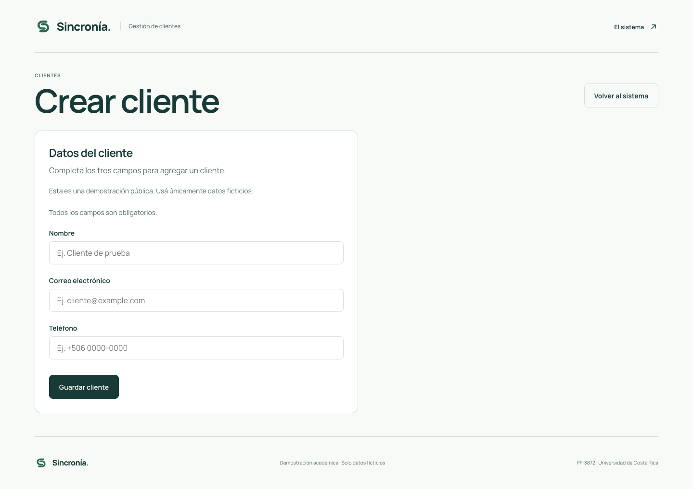
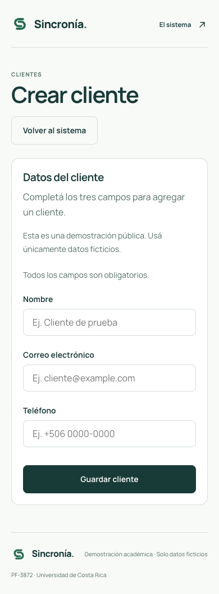
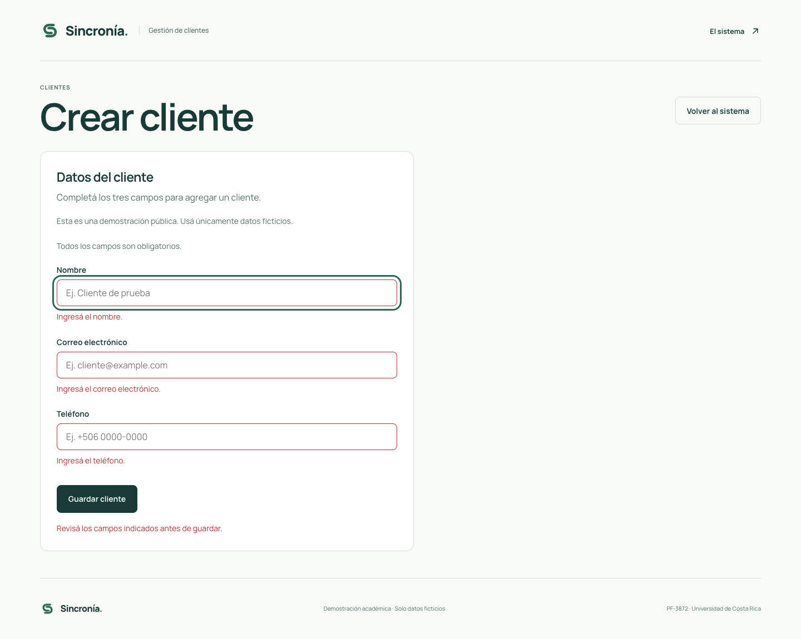
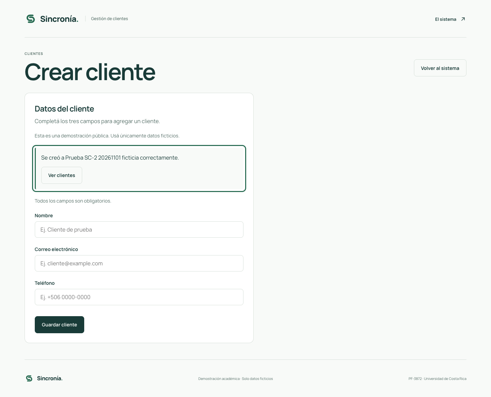

# SC-2 · Evidencia de creación de clientes

Historia: [SC-2](https://codefive.atlassian.net/browse/SC-2). Rama: `feature/SC-2-crear-cliente`.

## Validación realizada

- `npm run check`: revisión estática, tipos, compilación y 24 pruebas aprobadas; 8 nuevas cubren las reglas de creación.
- Navegador Chromium, aplicación local con `npm run dev` y configuración de `sincronia-dev`. Pruebas reales con dos clientes ficticios y correos de example.com.
- Formulario vacío: tres errores asociados, campos resaltados y foco en Nombre.
- Correo inválido: error junto a Correo electrónico y foco en ese campo; ningún guardado.
- Alta válida: INSERT con únicamente nombre, correo y teléfono; correo recortado y convertido a minúsculas. Fila confirmada por la API y verificada en Supabase y en el listado de José.
- Envío lento: se retuvo temporalmente la petición de red desde las herramientas del navegador y se dispararon dos envíos. Se observó una sola petición, campos deshabilitados, “Guardando…” y ningún éxito anticipado. Al liberar la petición real, apareció la confirmación y se limpiaron los campos.
- Correo duplicado real, usando mayúsculas y espacios: error 23505 traducido junto al correo, foco en ese campo y valores conservados; el cliente existente no se sobrescribe.
- Navegador sin conexión: mensaje de guardado no confirmado, valores conservados y controles habilitados para recuperarse.
- Respuesta simulada 201 sin fila: no se anuncia éxito. Esta comprobación sustituyó solo la respuesta de red del navegador; no insertó un registro.
- Teclado: entrada al título de la pantalla, Tab al formulario, foco visible, envío con Enter, confirmación enfocada y acceso al listado mediante Tab + Enter.
- Vista de 1440 px y vista móvil de 390 px. En móvil, ancho del documento igual al viewport, sin desplazamiento horizontal; campos de 16 px.

Los dos registros de esta comprobación se eliminaron al finalizar mediante filtros específicos de sus identificadores o correos y datos ficticios. La BD confirmó la eliminación de ambos; no se modificó el contenido de otros participantes.

## Reproducir

1. `npm ci`, copiar `.env.example` a `.env.local` si hace falta y ejecutar `npm run dev`.
2. Abrir Crear cliente desde la portada. Guardar vacío y probar un correo como `correo-invalido`.
3. Crear un registro con nombre ficticio, correo único de example.com y teléfono ficticio. Esperar la confirmación y abrir Ver clientes.
4. Intentar otro cliente con ese mismo correo cambiando mayúsculas y espacios exteriores. Debe señalar el duplicado sin sobrescribir.
5. Probar el formulario con conexión deshabilitada desde las herramientas del navegador. Restaurarla después de verificar el error.
6. Revisar teclado y ancho de 390 px. Eliminar únicamente el registro ficticio propio al terminar.

## Capturas

